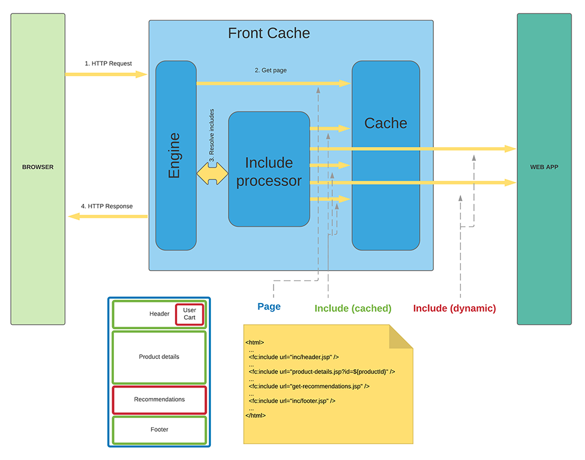

## Frontcache = [includes + fragment cache] x edge side

#### Get started

|                       |                                                                                                                                                         |
|-----------------------|---------------------------------------------------------------------------------------------------------------------------------------------------------|
| **See it on YouTube** | [Concept Intro (5min)](https://www.youtube.com/watch?v=Kjyeih0d9qY),  [Demo with www.hobbyray.com (13min)](https://www.youtube.com/watch?v=5RcZPcZgwFI) |
| **See the payoff**    | [Value proposition](docs/value.md) — measured A/B on 100k real requests                                                                                 |
| **Understand it**     | [Concepts](docs/concept.md) — fragment caching, request lifecycle, ...                                                                                  |
| **Install it**        | [Install guide](docs/install-guide.md) — library, archive, installer script, or container                                                               |
| **Download it**       | [Downloads](docs/downloads.md) — direct links to every artifact, 2.11.0 and 2.10.0                                                                       |
| **Choose a topology** | [Deployment use cases](docs/deployment-usecases.md) — filter, standalone proxy, or multi-region                                                         |
| **See it work**       | [Java / Spring Boot](examples/frontcache-spring) · [PHP](examples/frontcache-php) — each runs with one command                                          |
| **See what changed**  | [Release notes](docs/release-notes/) — 2.7.0, 2.8.0, 2.9.0, 2.10.0, 2.11.0                                                                                      |
| **Read more**         | [Documentation index](docs/doc-index.md)                                                                                                                |

Quickest look, if you have Docker:

```sh
docker run -d --name frontcache -p 8080:9080 \
  -e ORIGIN_HOST=your-origin.example.com \
  pavlikovskiy/frontcache-server:2.11.0
```


#### Features

* Reduce server response time for dynamic pages 

* Reduce backend load dozen times! 
   
* Increase application's resilience

* Can be used with web apps written in any language





#### Build from source

This repository is the product source as well as its documentation: `frontcache-core` (the engine),
`frontcache-server` (the standalone proxy), `frontcache-console`, `frontcache-agent` and the end-to-end
suite `frontcache-tests`. A JDK 25 is the only prerequisite (`node`, when present, also runs the
console's JavaScript tests).

```sh
./gradlew build      # compile, unit tests, license-header and third-party-license checks
./gradlew dist       # the server and console bundles, under */build/distributions
./tests.sh           # the end-to-end suite (starts two embedded Jetty nodes and a console)
```

The examples under `examples/` do not build against this source: they consume the published
artifacts, exactly as an application would.


#### License

Frontcache is licensed under the [Apache License 2.0](LICENSE); see [NOTICE](NOTICE) for the
third-party material in the source tree. Frontcache Pro - additional modules that plug into the same
node and console - is available under a commercial license and is not part of this repository or of
any distribution built from it: https://www.eternita.co/frontcache-license.html
