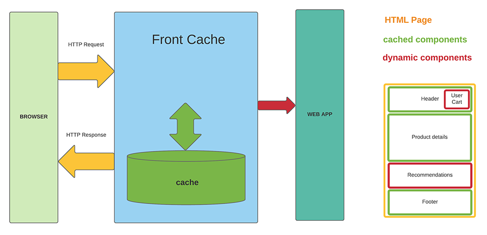

## Frontcache - (development project).

### [it's page fragment cache + remote includes + concurrent execution]

#### Features

* Reduce server response time for dynamic pages 

* Reduce backend load dozen times! 
   
* Increase application's resilience

* Can be used with web apps written in any language

Frontcache developed & tested with Java based Web apps but can be used with other languages/technologies as well. 

